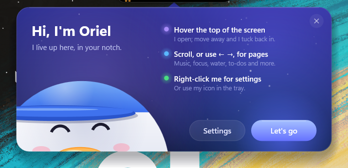
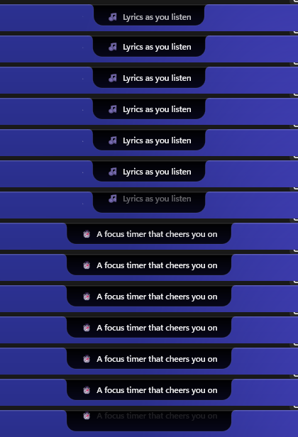

  
  <h1>Oriel</h1>
  
<strong>A little living notch for your Windows desktop.</strong>

  
Your music, lyrics, focus sessions and everyday reminders, gathered at the top of your screen — with a tiny duck for company.

  

    <a href="https://raw.githubusercontent.com/Niix-x/Oriel-Releases/v1.0.0/OrielSetup-1.0.0.exe"><strong>↓ Download Oriel 1.0.0</strong></a>
    &nbsp; · &nbsp;
    <a href="https://github.com/Niix-x/Oriel-Releases/releases/tag/v1.0.0">Release notes</a>
  

  
Free download · Windows · First release: v1.0.0

  

Hover over the notch to bring Oriel's friendly cards and shortcuts into view.

<a href="#what-oriel-does">Features</a> · <a href="#a-closer-look">Previews</a> · <a href="#get-started">Install</a> · <a href="https://github.com/Niix-x/Oriel-Releases/releases">All releases</a>

---

## What Oriel does

Oriel sits at the top edge of your screen. It stays compact while you work, then opens into useful pages and cards when you hover or interact with it.

| 🎵 Music & lyrics | ⏱️ Focus & routines |
| --- | --- |
| See what's playing in Spotify, your browser or another media app. Browse synced lyrics when available, and use the compact player controls. | Run a Pomodoro focus timer, keep a to-do list, and get gentle water reminders with a daily intake view. |
| 📅 Calendar & reminders | 🎛️ Handy controls |
| See today's agenda and upcoming events, with Windows calendar and subscribed iCal calendars. Oriel can also surface Windows notifications and timely task reminders. | Reach volume, brightness and other quick controls from the notch. Check weather, keep files or text close at hand on the shelf, and get out of the way during full-screen apps. |

## A closer look

  
  

Compact when you're busy; expressive when you need it.

## Get started

1. **[Download Oriel 1.0.0](https://raw.githubusercontent.com/Niix-x/Oriel-Releases/v1.0.0/OrielSetup-1.0.0.exe)** for Windows.
2. Open `OrielSetup-1.0.0.exe` and follow the setup prompts.
3. Launch Oriel. Move your pointer to the top edge of the screen to open it; right-click the notch or its tray icon for settings.

Some integrations need Windows access or a connected app/account. Music lyrics are available when a matching synced track can be found.

## Release history

- **[v1.0.0 — First release](https://github.com/Niix-x/Oriel-Releases/releases/tag/v1.0.0)** · installer and release notes

## About this repository

This is Oriel's public downloads page. It contains the installer and preview images; the application source code is kept in a separate private repository.

Made with care by <a href="https://github.com/Niix-x">Niixx_andria</a> · <a href="https://github.com/Niix-x/Oriel-Releases/releases">Get Oriel</a>

