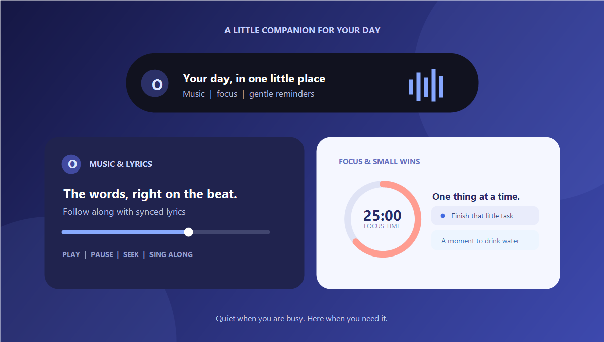
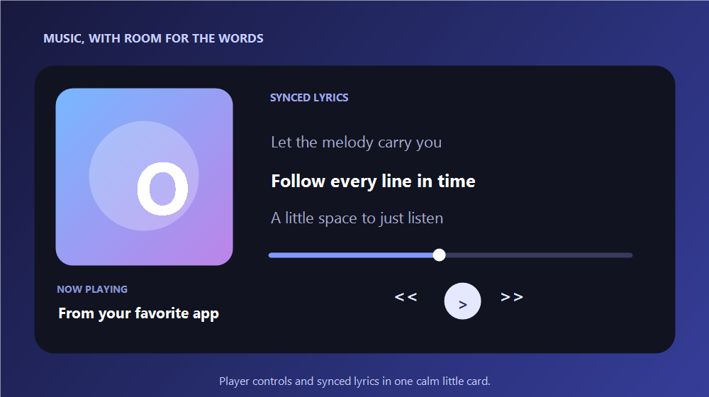
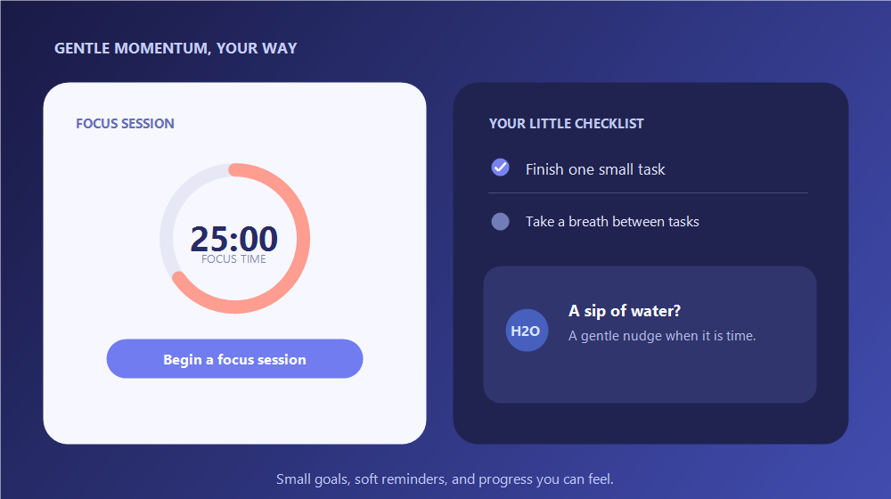

  
  <h1>Oriel</h1>
  
<strong>A little living notch for your Windows desktop.</strong>

  
Music, lyrics, focus and gentle reminders — tucked into a friendly companion at the top of your screen.

  
<a href="https://raw.githubusercontent.com/Niix-x/Oriel-Releases/v1.0.0/OrielSetup-1.0.0.exe"><strong>↓ Download Oriel 1.0.0 for Windows</strong></a> · <a href="https://github.com/Niix-x/Oriel-Releases/releases/tag/v1.0.0">Release notes</a>

## A little more life at the top of your screen

Oriel stays compact while you work, then opens into useful pages and cards when you hover or interact with it.

- **Music and lyrics:** see what's playing in Spotify, a browser or another media app. Use the player controls and follow synced lyrics when available.
- **Focus and routines:** run Pomodoro sessions, keep a to-do list with timed reminders, and get gentle water nudges.
- **Calendar and reminders:** see today's agenda and upcoming events from Windows calendars or an iCal subscription.
- **Quick controls:** reach volume and brightness, check weather, and keep files or text nearby on the shelf. Oriel steps aside for full-screen apps.

## Made for listening and getting things done

  
  

## Install

1. Download **OrielSetup-1.0.0.exe** above.
2. Open the installer and follow the setup prompts.
3. Launch Oriel, then move your pointer to the top of the screen to open it. Right-click the notch or tray icon for settings.

Oriel keeps its settings, tasks, water and focus records on your PC. Spotify credentials and calendar links are kept in Windows Credential Manager. Optional Windows calendar and notification integrations may ask for access.

## v1.0.0 · First release

[Open the public release page](https://github.com/Niix-x/Oriel-Releases/releases/tag/v1.0.0) for the full overview and installer download.

Made with care by <a href="https://github.com/Niix-x">Niixx_andria</a> · The application source remains private.

