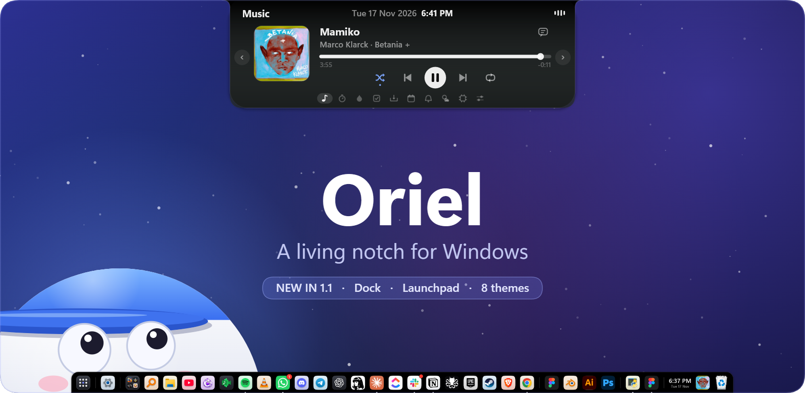
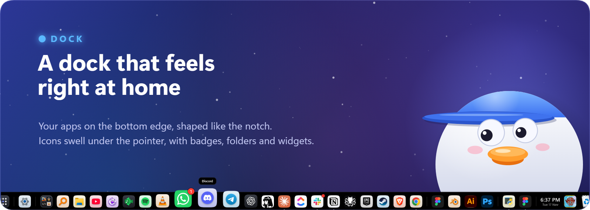
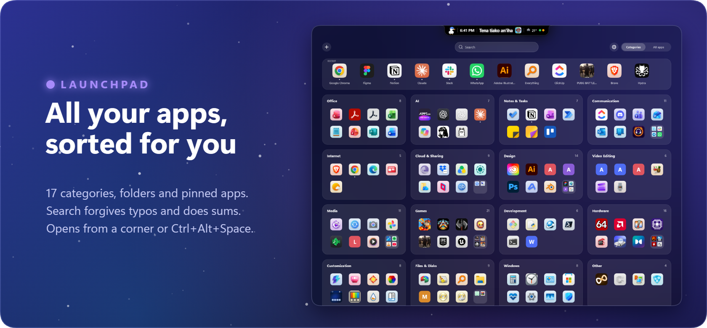
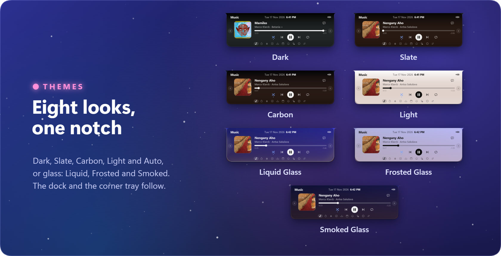
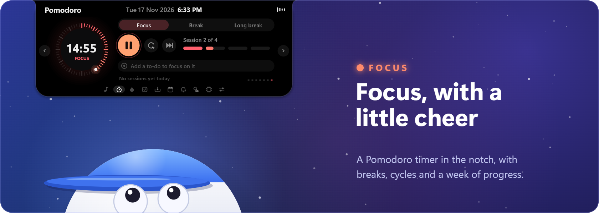
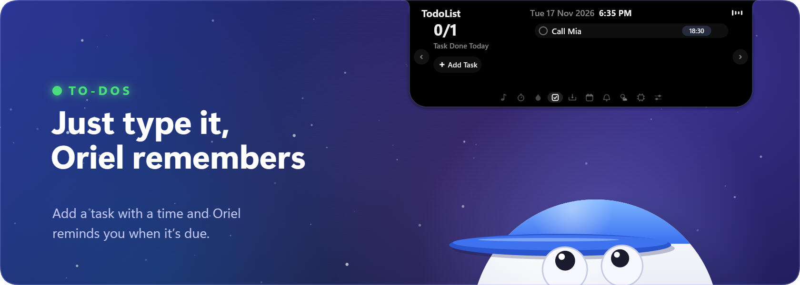
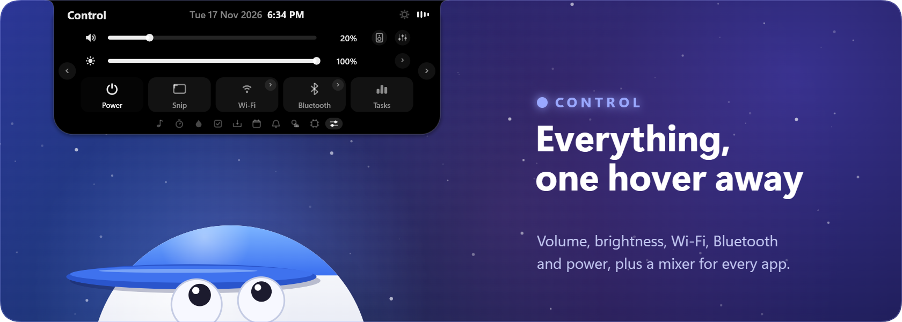
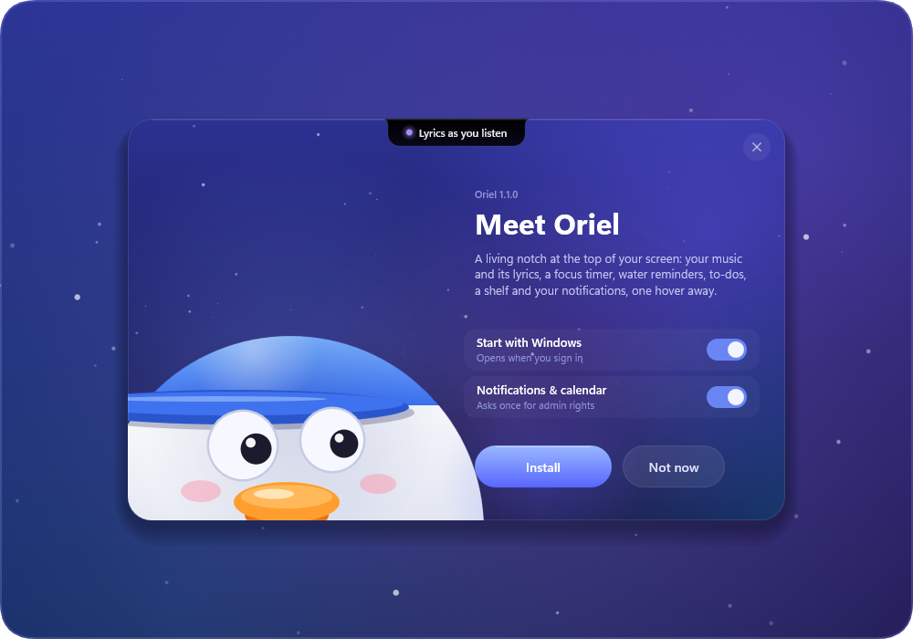
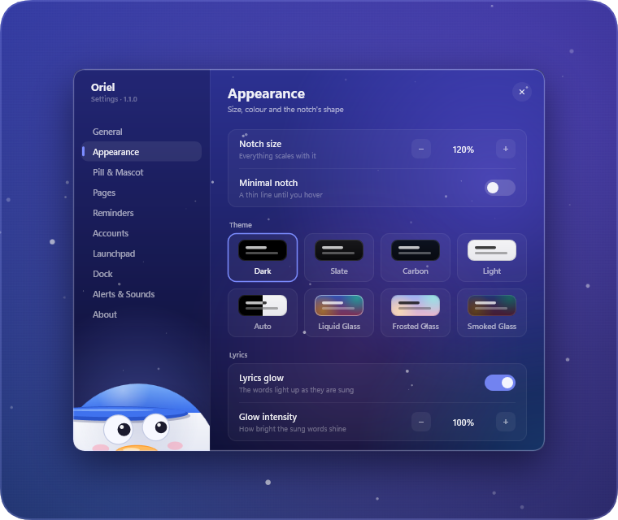

  

  

  Windows 10 (version 2004 or later) and Windows 11 · <a href="https://github.com/Niix-x/Oriel-Releases/releases/tag/v1.1.0">Release notes</a>

https://github.com/user-attachments/assets/9e195c85-ced3-41a0-8d88-d8af86673a79

 

Oriel is a small notch that lives at the top of your screen. Hover it and it opens: your music and its lyrics, a focus timer, your to-dos, water reminders, your calendar, your notifications and quick controls. Move away and it tucks back in. Since 1.1 it also brings a dock for your apps, a Launchpad and eight themes.

## New in 1.1

## In the notch

### And there's more

- **Music and lyrics.** What's playing in Spotify, your browser or any player, with synced lyrics that light up as they're sung.
- **Water.** A daily goal, gentle reminders through the day, and a streak to keep.
- **Calendar.** Today's agenda and the month, from your Windows accounts or any iCal link, with public holidays.
- **Notifications.** Your Windows notifications in one place, opened with a click.
- **Shelf.** Drop files or snippets on the notch to keep them close, then drag them back out.
- **System.** Processor, graphics and memory load, and each drive's free space.
- **Corner tray.** The tray icons Windows hides, in a small notch in the top-right corner.
- **Weather** for the next hours, and a **duck** (or a pair of eyes) that keeps you company.

## Install

  
  

1. [Download OrielSetup-1.1.0.exe](https://github.com/Niix-x/Oriel-Releases/releases/download/v1.1.0/OrielSetup-1.1.0.exe).
2. Open it. Windows may say *Windows protected your PC*, because the setup isn't signed yet: click **More info**, then **Run anyway**.
3. Choose your options and click **Install**. Oriel installs for you only, without admin rights. Turning on notifications and calendar asks for permission once.
4. Move your pointer to the top of the screen. Right-click the notch, or its tray icon, for Settings.

To remove Oriel, use **Settings > Apps > Installed apps** in Windows. Your tasks and settings stay unless you choose to delete them.

## Privacy

Oriel keeps everything on your PC: settings, tasks and your water and focus history in `%APPDATA%\Oriel`, and calendar links and Spotify sign-in in Windows Credential Manager. It goes online only for lyrics, the weather, public holidays, the calendar links you add, and Spotify if you connect it.

## Community

- **Questions and help:** [Discussions › Q&A](https://github.com/Niix-x/Oriel-Releases/discussions/categories/q-a)
- **Ideas:** [Discussions › Ideas](https://github.com/Niix-x/Oriel-Releases/discussions/categories/ideas)
- **Your setups:** [Discussions › Show and tell](https://github.com/Niix-x/Oriel-Releases/discussions/categories/show-and-tell)
- **Bugs:** [open an issue](https://github.com/Niix-x/Oriel-Releases/issues/new/choose)

Read [Contributing](CONTRIBUTING.md), [Support](SUPPORT.md) and [Security](SECURITY.md) for the details. Everyone here follows the [code of conduct](CODE_OF_CONDUCT.md).

## License

Oriel is free to download and use, at home or at work. It may not be sold or redistributed elsewhere; see the [license](LICENSE).

 

Made with care by <a href="https://github.com/Niix-x">Niixx_andria</a>

