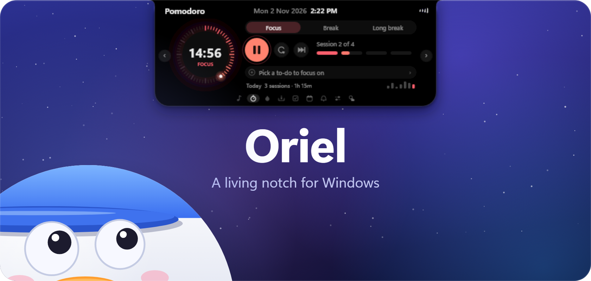
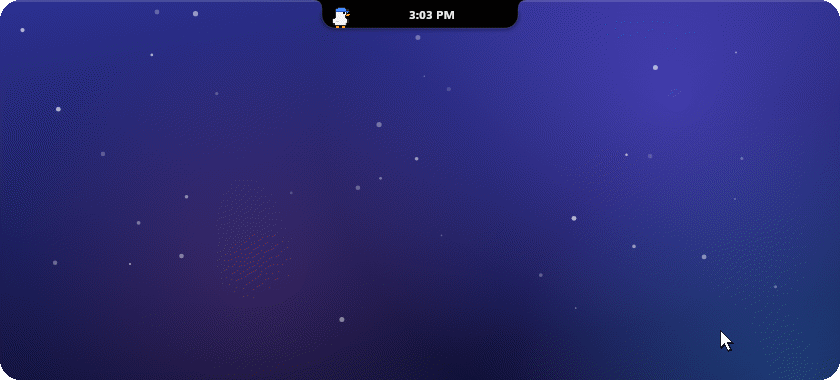

  

  

## Hello, I'm Oriel 👋

This is the first release. Oriel is a small notch that lives at the top of your screen: hover it and it opens, move away and it tucks back in.

### What's inside

- **Music and lyrics** from Spotify, your browser or any player, with synced lyrics that light up as they're sung.
- **Focus**: a Pomodoro timer with breaks, cycles and a week of progress.
- **To-dos** with timed reminders and Snooze.
- **Water** reminders with a daily goal and a streak.
- **Calendar** from your Windows accounts or any iCal link, with public holidays.
- **Notifications** from Windows, gathered in one place.
- **Quick controls**: volume, brightness, a mixer for every app, Wi-Fi, Bluetooth and power.
- **Shelf** for files and snippets, **weather**, and a **duck** that keeps you company.

### Install

1. Download **OrielSetup-1.0.0.exe** with the button above.
2. Open it. Windows may say *Windows protected your PC*, because the setup isn't signed yet: click **More info**, then **Run anyway**.
3. Choose your options and click **Install** (no admin rights needed).
4. Move your pointer to the top of the screen. Right-click the notch for Settings.

Requires Windows 10 (version 2004 or later) or Windows 11.

### Good to know

- Signing in to Spotify (for likes and Up next) isn't working yet. Music, lyrics and playback controls work without it.
- Calendars come from your Windows accounts or an iCal link; signing in to Google or Microsoft directly is coming later.
