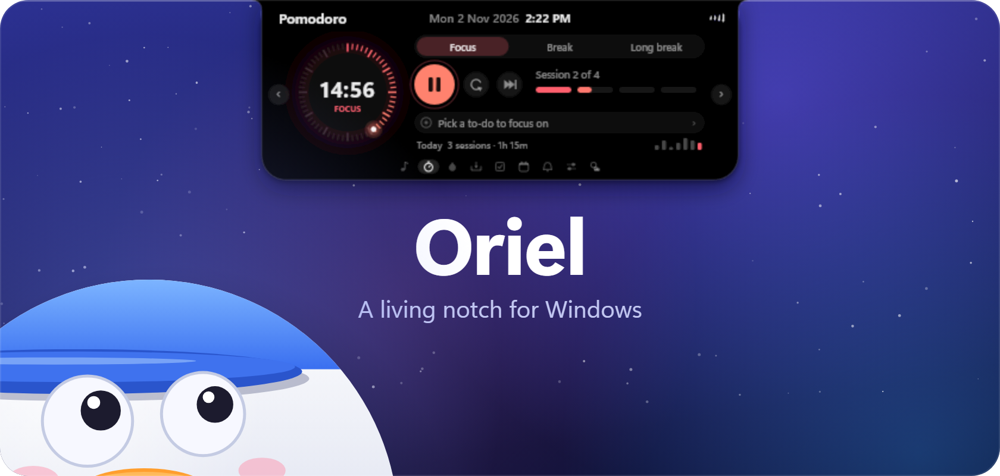

  

  

## Oriel 1.1.0

A big one: a dock, a Launchpad, themes and sounds, and notifications that arrive faster.

### What's new

- **A dock** on the bottom edge of the screen, shaped like the notch upside down: your kept and open apps, live window previews, badges, folders, separators and widgets (Recycle Bin, clock, now playing, processor and memory). Always shown, auto-hidden, or smart auto-hidden.
- **The Launchpad**: a full-screen view of your apps in 17 categories, with folders, pinning, search that forgives typos and does sums, and your own names and icons. Opens from the top-left corner or Ctrl+Alt+Space.
- **Eight themes**, including Liquid Glass, for the notch, the dock and the corner tray, plus one icon style for every app and a per-icon editor.
- **Sounds**: short chimes for focus, breaks, water, to-dos and headphones, all made by Oriel itself and quiet in Do Not Disturb and full-screen games.
- **Notifications** reach the notch in about a fifth of a second, can show only in Oriel instead of Windows' banners, and Phone Link calls ring in the notch with an Accept on PC button.
- **A corner tray** in the top-right corner for the tray icons Windows hides, updated live.
- **A System page** (CPU, GPU, memory, drives), a mic and camera dot on the pill, USB drive cards with Eject, and hot corners.
- **The pill builder**: arrange what the closed notch shows by dragging.
- The water reminder now waits until you answer it, and Settings has been reorganized into ten tabs.

The full list is in the [changelog](https://github.com/Niix-x/Oriel/blob/main/CHANGELOG.md).

### Install

1. Download **OrielSetup-1.1.0.exe** with the button above. It updates an existing Oriel and keeps your settings.
2. Open it. Windows may say *Windows protected your PC*, because the setup isn't signed yet: click **More info**, then **Run anyway**.
3. Choose your options and click **Install** (no admin rights needed).

Requires Windows 10 (version 2004 or later) or Windows 11.

### Good to know

- Signing in to Spotify (for likes and Up next) still isn't working. Music, lyrics and playback controls work without it.
- Calendars come from your Windows accounts or an iCal link; signing in to Google or Microsoft directly is coming later.
