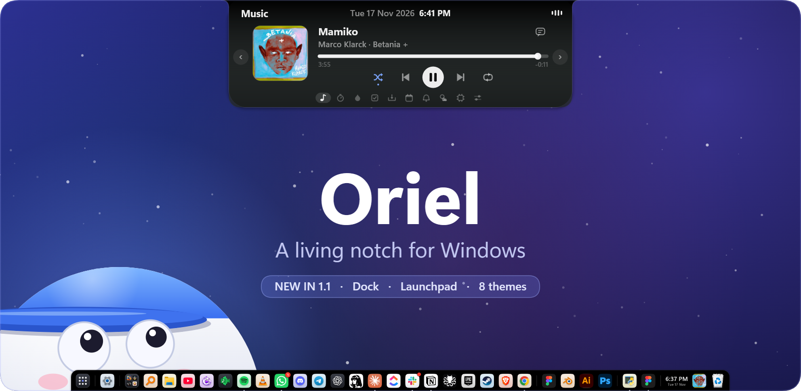

  

  

## Oriel 1.1.1

A small one that makes the next ones easy: Oriel now updates itself.

### What's new

- **Updates in the notch.** Oriel looks for a new version half a minute after it starts, then every hour. When one is out, the notch says so: **Update** downloads it, checks it's the very file published here, installs it and starts the new version in a few seconds, with your settings and data as they were. The tray menu offers it too.
- **What's new.** Read a new version's notes before you update, and see what changed right after updating. Settings › About opens the whole changelog any time.
- **GitHub, one click away.** View on GitHub in What's new, and a GitHub button in Settings › About.
- Settings › About shows whether Oriel is up to date, with **Check now**, and **Check automatically** to turn the hourly look off.

### Install

This is the last version you install by hand: from 1.1.1 on, Oriel updates itself.

1. Download **OrielSetup-1.1.1.exe** with the button above. It updates an existing Oriel and keeps your settings.
2. Open it. Windows may say *Windows protected your PC*, because the setup isn't signed yet: click **More info**, then **Run anyway**.
3. Choose your options and click **Install** (no admin rights needed).

Requires Windows 10 (version 2004 or later) or Windows 11.

### Good to know

- To look for updates, Oriel asks GitHub which version is the latest, once an hour. It sends nothing else, and Settings › About turns it off.
- Signing in to Spotify (for likes and Up next) still isn't working. Music, lyrics and playback controls work without it.
- Calendars come from your Windows accounts or an iCal link; signing in to Google or Microsoft directly is coming later.
