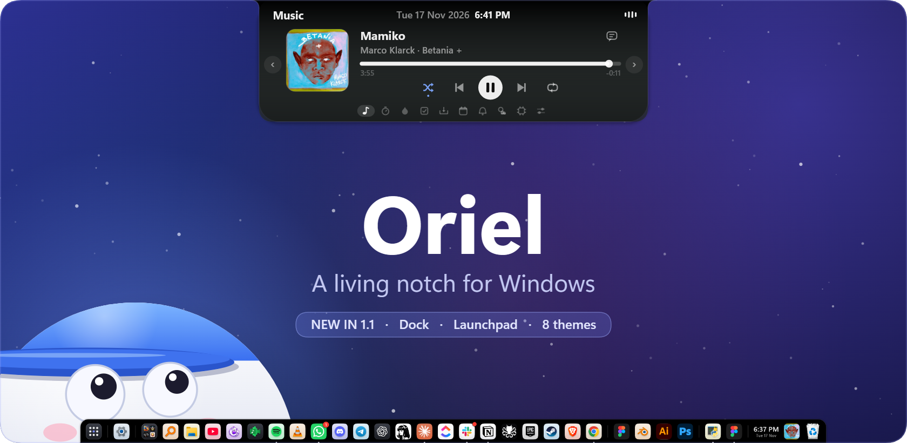

  

  

## Oriel 1.2

Lighter, smoother, and a dock that does more. Thanks to everyone who shared feedback in the discussions: most of this release comes from it.

### Lighter and smoother

- **Far less of your PC.** Resting, Oriel now uses about a tenth of what it did (well under 1 % of the CPU, even with music playing), and about a third less memory.
- **A new way of drawing.** Oriel now draws with DirectComposition, straight on the graphics card, so every frame costs a fraction of what it did.
- **Smooth at any refresh rate.** Animations follow your screen's own refresh, so they stay fluid on 120 and 240 Hz screens, even when nothing else on the screen moves.
- **No more Launchpad freezes.** Moving apps between groups could freeze the PC for a few seconds while the "Moved to…" message showed. Fixed, and dragging apps no longer hitches.
- Glass themes no longer stall the notch, the visualizer only listens while something plays, and Oriel checks the pointer less often while it rests.

### Dock

- **Each app's volume, in its window previews.** While an app plays sound, a row under its windows has a speaker and a slider: mute it, or set its own volume, as in Windows' volume mixer.
- **Peek.** Rest the pointer on a window in the previews and every other window fades away, as the taskbar's previews do.
- **Hide Windows' taskbar, for real.** The taskbar no longer pops back after a full-screen app, and no empty strip is left at the bottom of the screen.

### Notifications

- Click a notification as it comes in, in the notch, to open it; moving onto it no longer opens the notch.
- In the notifications list, click anywhere on a notification to open it, and use the small arrow to read the whole text of a long one.

### Settings

- **Keep space for the notch** (General › Behaviour): turn it off and apps use the whole screen, with the notch floating over them.
- **Reduce motion** (Appearance): shorter, calmer animations. By default it follows Windows' own animation setting.
- On battery or in energy saver, animations run at a gentler pace.

### Install

If you have Oriel 1.1.1, it updates itself: the notch offers 1.2 within the hour (or open Settings › About › Check now).

Otherwise:

1. Download **OrielSetup-1.2.0.exe** with the button above. It updates an existing Oriel and keeps your settings.
2. Open it. Windows may say *Windows protected your PC*, because the setup isn't signed yet: click **More info**, then **Run anyway**. Or get **Oriel Notch** from the [Microsoft Store](https://apps.microsoft.com/detail/9NRR2MQPZ9ZL), signed by Microsoft.
3. Choose your options and click **Install** (no admin rights needed).

Requires Windows 10 (version 2004 or later) or Windows 11.
